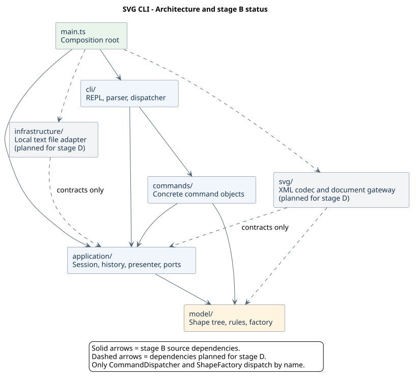

# Lab1 Phase 1：架构方案与开发记录

仓库：[tsx543/svg-editor](https://github.com/tsx543/svg-editor)。本文件对应作业要求的正式工程文档。

**当前阶段：2026-10-20，阶段 A 已完成。** 六种基础图形、`init/canvas/create/tree/show/help` 及创建的撤销重做已经实现，45 项测试通过（含后续补充的外部依赖规则回归测试）。下文同时保留完整 Phase 1 的架构目标；未开放的编辑、层级和 SVG 读写能力仍是计划，不能据此认为整个作业已完成。

课程平台最终上传根目录的 `README.md`，其中包含仓库地址；本文件随代码保存在仓库的 `doc/README.md`。最终验收和提交完成后，才在最终提交上创建并推送 `final` 标签。

## 架构方案

### 1. 本阶段要完成什么

实现 TypeScript 命令行 SVG 编辑器，内置 `rect/circle/ellipse/line/text/g` 六种类型，完成作业命令总表中的全部命令。`box`、插件加载、GUI 和鼠标操作属于后续范围。

以下是老师明确提出、实现时必须检查的约束：

| 要求 | 我们的落实方式 |
| --- | --- |
| TypeScript + 面向对象 | 图形和命令使用类、封装和多态；一类一文件，文件名与类名相同；不把业务写成公共数据袋和自由函数 |
| 必须使用 Command | 每种命令有对应命令对象；编辑命令支持撤销和重做 |
| 容器与叶子统一操作 | 使用共同的 `Shape` 抽象；普通图形与 `Group` 都能移动、缩放、设置样式及作为整棵子树删除 |
| 名字分派仅允许两处 | 命令名在 `CommandDispatcher` 分派，图形类型名在 `ShapeFactory` 分派；两处均标为待重构 |
| id 唯一、区分大小写 | 由文档维护全局索引；创建和结构变化统一校验 |
| 失败不改变任何状态 | 在副本上校验和修改，成功后再替换当前文档并更新历史 |
| 分步 Git 提交与真实过程记录 | 设计、功能阶段和修正分别形成真实提交；不在最后补造历史 |

### 2. 模块划分与职责

采用六个目录。让图形规则处在底层，终端和文件放在外层，避免更换交互方式时重写图形逻辑。

| 目录 | 职责 | 计划中的主要类或接口 |
| --- | --- | --- |
| `src/cli/` | 逐行输入、`svg>` 提示符、引号和注释解析、唯一的命令名分派、输出结果 | `Cli`、`CommandLineParser`、`CommandDispatcher` |
| `src/commands/` | 一条命令一个对象；解释该命令的参数，调用应用和模型能力 | `EditCommand`、`CreateCommand`、`MoveCommand`、`GroupCommand`、`ReadCommand` 等 |
| `src/application/` | 管理当前文档、默认读入路径、撤销重做和执行事务；生成树与明细的排版结果；声明外部能力接口 | `EditorSession`、`History`、`DocumentPresenter`；`Command`、`UndoableCommand`、`DocumentGateway`、`FileStore` 接口 |
| `src/model/` | 文档树、图形行为、属性白名单、父子关系、id 索引和唯一的图形类型分派 | `SvgDocument`、`Shape`、`Rect`、`Circle`、`Ellipse`、`Line`、`Text`、`Group`、`ShapeFactory`、`Transform` |
| `src/svg/` | XML 与模型互转；SVG 根节点、缺失 id、变换及支持范围检查；组合文件接口完成文档读写 | `SvgCodec`、`SvgDocumentGateway` |
| `src/infrastructure/` | 实际读写本地文本文件；保存时采用临时文件和替换，减少写坏目标文件的风险 | `NodeFileStore` |

`src/main.ts` 是组装入口：创建对象、传入依赖并启动，不放业务规则。接口放在所属模块的独立同名文件中；只读参数和结果可以作为边界数据，真正的文档与图形仍由有行为的类维护。

阶段 A 已落地 `cli/commands/application/model` 四个模块。`DocumentGateway/FileStore` 接口、`svg/infrastructure` 模块和 `Transform` 留至阶段 D，不为占位建立空类；图中的虚线表示这些后续依赖。模型的普通移动、缩放和属性行为已作为图形类的方法实现并单测，但本阶段尚未开放相应 CLI 命令。

计划目录如下，目前不为占位而创建空类：

```text
svg-editor/
├── src/
│   ├── main.ts
│   ├── cli/
│   ├── commands/
│   ├── application/
│   │   └── contracts/
│   ├── model/
│   ├── svg/
│   └── infrastructure/
├── tests/                 # 随实际功能建立
├── examples/              # 命令回放和 SVG 样例
├── doc/
│   ├── README.md
│   ├── architecture.puml
│   └── architecture.svg
└── README.md              # 课程平台上传文件及运行入口说明
```

### 3. PlantUML 组件图

箭头表示源码依赖方向；实线为阶段 A 已落地的依赖，虚线为阶段 D 的目标依赖。标注 `contracts only` 的依赖只允许使用应用层的接口。这不是程序调用先后顺序图。



可编辑源文件：[architecture.puml](architecture.puml)。采用 [PlantUML 组件图语法](https://plantuml.com/component-diagram)，保留源文件和渲染图，便于复核和后续修改。

### 4. 设计模式怎样落地

#### Command：把一次编辑变成可恢复的操作

`Command` 接口放在应用层，由具体命令实现。`CommandDispatcher` 找到命令后，统一调用其执行方法。`create` 同样是编辑命令，不能绕过命令体系。

- 每个具体编辑命令只负责一项操作，例如 `MoveCommand` 调用模型的移动方法。
- `EditCommand` 抽象基类统一组织编辑过程；`History` 保存成功的可撤销命令对象。
- 每个编辑命令保存执行前、执行后的深拷贝快照，辅助 `undo/redo` 恢复。快照对应 Memento 思路，服务于 Command，不能代替具体命令对象。
- 图形通过多态 `clone()` 复制，容器递归复制子节点；不能在恢复时再写一套 `switch(tag)`。
- 命令以 id 定位图形，不长期持有当前树中可变图形的引用，避免替换快照后仍操作旧对象。
- 以快照换取简单可靠的恢复，适合本次小型文档。大图内存开销较高，后续有实际需求再改为记录差量。

例如 `group markers c1 box` 只产生一个命令对象、一个历史单元。撤销时恢复原父容器、顺序和整棵树，不拆成三次撤销。

#### Composite：容器和普通图形使用相同入口

`Shape` 定义移动、缩放、属性设置、复制和只读描述等操作。具体图形封装自己的几何状态；`Group` 封装有序子节点，对移动和缩放递归调用同一接口。

`SvgDocument` 负责挂接、摘取、删除子树和维护 id 索引。命令无需区分“这是矩形还是组”。`Group` 的样式设置写在组自身，使用 SVG 继承语义，不逐个覆盖孩子已有的显式样式。

几何字段、父指针和子节点数组不能作为可任意修改的公共字段暴露。几何描述提供只读值，子节点集合返回副本；`SvgDocument.find()` 返回可操作的图形，因此命令仅在会话提供的文档副本内访问和修改图形。结构修改必须走模型方法，避免绕过循环检查和 id 校验。

#### 图形工厂：创建和读回共用一个类型入口

`ShapeFactory` 是唯一的“类型名 → 图形类”分派位置。`create rect ...` 和读取 `<rect ...>` 都经过这个入口；不同输入由小型输入对象提供参数、属性和文字，具体图形负责解释自身字段。

`SvgCodec` 只能遍历 XML 并调用工厂，不能再建一张“SVG 标签 → 构造器”的表。根 `<svg>` 的文档解析由编解码器负责，不属于图形类型分派。

序列化时，每种图形通过多态方法提供标签、属性、文本和子节点；`SvgCodec` 通用遍历并转义。显示时，图形提供只读几何描述，`DocumentPresenter` 仅处理树线、缩进、父节点和排版。两者都不使用 `switch(tag)` 或 `instanceof Rect/...` 分支链。

#### 两处允许的名字分派，均列为待重构

| 位置 | 本阶段做法 | 待重构事项 |
| --- | --- | --- |
| `cli/CommandDispatcher.ts` | 集中维护命令名与命令类的对应关系 | 新增命令仍需修改此处；后续需要动态扩展时，再引入命令注册机制 |
| `model/ShapeFactory.ts` | 集中维护六种内置类型；CLI 创建与 SVG 导入共享这张表 | 新增类型仍需修改此处；后续插件阶段再演进为提供者注册机制 |

把额外的类型分支换成 Map 也仍然属于名字分派，不能借此规避限制。属性白名单和数字格式检查属于输入校验，不新增命令或图形类型分派表；属性操作由所属对象负责，避免再建立属性名到自由业务函数的分发表。

### 5. 依赖方向规则

| 模块 | 可以依赖 | 不能依赖或不能做的事 |
| --- | --- | --- |
| `model` | 自身模块及语言基础能力 | 不导入命令、应用、终端、文件系统或 XML 库 |
| `application` | `model`、自身接口 | 不导入具体命令类、SVG 编解码器或本地文件实现 |
| `commands` | `application`、`model` | 不直接读写文件、不调用终端、不自行解析 XML |
| `cli` | `commands`、`application`、Node 终端能力 | 不直接修改图形字段、不读写 SVG 文件 |
| `svg` | `model`、`application/contracts`、选定的 XML 库 | 不依赖 CLI 或具体命令，不新增图形类型分发表 |
| `infrastructure` | `application/contracts`、Node 文件系统能力 | 不决定图形规则、命令语义或历史策略 |
| `main.ts` | 以上所有模块 | 只组装依赖，不承载编辑逻辑 |

其中 `DocumentGateway` 表达“读入或保存一个文档”，`FileStore` 表达“读写一段文本”。`SvgDocumentGateway` 和 `NodeFileStore` 分别实现它们。接口属于应用层，因此应用无需反向导入外部实现。

生产源码的外部依赖按模块检查：`cli/infrastructure` 可使用 Node 内置模块，`svg` 可使用显式选定的 XML 解析包及其包内子路径；其他业务模块不直接使用这些外部能力。XML 包白名单由 `tests/architecture.test.ts` 的 `selectedXmlPackages` 声明，扫描和正反例均复用测试辅助类 `ExternalDependencyPolicy`。**当前尚未选型，因此名单为空，不代表架构永久禁止 XML 库。** 阶段 D 选型时，应在同一提交中更新依赖清单、该白名单和选型记录，不放开 SVG 对任意第三方包的访问。

测试代码使用的 `@babel/parser` 属于开发依赖，不在 `src/` 生产导入扫描范围；它也不是提前选定的 SVG 解析库。

测试可以导入被测模块，生产代码不能反向导入测试。任何未列出的跨模块依赖，都先记录并检查理由；需要调整时先修订规则，不默认放行。

### 6. 对行为的明确约定

下面把老师的硬性要求与项目补充选择分开。补充选择用于消除歧义，**不是老师原文**；若老师补充说明，应修改方案和测试。

| 事项 | 老师明确要求 | 本项目补充的执行约定 |
| --- | --- | --- |
| 编辑历史 | 一条编辑一个撤销单元；新编辑清空 redo | 只记录成功编辑；撤销和重做成功后才移动历史指针 |
| 文件操作后的历史 | `init/read/save`、修改尺寸的 `canvas` 后禁止撤销重做，直到下一次编辑 | 这些操作成功后清空旧历史并开启屏障；新编辑从当前文档建立新历史。清空旧历史是本项目选择 |
| 失败原子性 | 命令失败不改变任何状态 | 文档、父子关系、顺序、路径、两栈和屏障均不变；读入警告缓冲至整次读取成功后再输出 |
| 普通查询 | `tree/show/help` 不进入历史 | 无参数 `canvas` 也只查询，不改变历史或屏障 |
| 缩放 | 因子必须为正；位置和尺寸同乘；组递归作用于子孙 | 数值必须有限；未带变换的图形绕 SVG 原点缩放；`stroke-width` 属样式，不随几何缩放；text 的可编辑几何只有 `x/y`，不额外增加 `font-size` 编辑 |
| 分组 | 从各自父级摘出，保持相对顺序；同时选择祖先和后代必须拒绝 | 新组放在原父级们的最近公共祖先下；组内按执行前文档的深度优先顺序排列，不按参数顺序。插入最早被选分支之前；若该分支被摘除，则复用其位置。其余节点相互顺序保持不变 |
| 分组参数 | 新组 id 必填且唯一 | 至少选择两个不同节点；重复参数报错，不静默去重 |
| 解组 | 子节点提升到父级、占据原组位置；根级容器禁止解组 | 逐个保留子节点顺序；撤销恢复组和原始下标。本阶段没有 `box` 解组实现 |
| 移动归属 | `addto` 作为目标组最后一个孩子 | 禁止移入自身或自己的后代；原本已在目标组内时也调整到末尾 |
| 同级前后 | `front/back` 只调整同级 z-order | `front` 移到 SVG 同级列表末尾，显示在最上层；`back` 移到列表开头 |
| 组的属性设置 | 公共样式白名单适用于组与叶子 | 设置组自身的 `fill/stroke/stroke-width`；未显式设置的后代遵循 SVG 继承，已有显式属性不被覆盖 |
| 默认保存路径 | 无参 `save` 保存到读入时的路径 | 仅成功 `read` 设置默认路径；`init` 清除它；带参 `save` 只指定本次目标。没有读入路径时，无参保存报错 |
| 缺失 id | 按标签名加序号补全并警告 | 先收集全文件显式 id，再从序号 1 起跳过已占用名称；重复显式 id 使整次读取失败 |
| 输入 | 双引号支持空格参数；`#` 开头为注释 | 一行首个非空白字符为 `#` 才视为注释；参数内的 `#ffffff` 保留为颜色；空行忽略 |
| 无文档 | 未初始化时其他操作报指定错误 | `help` 允许在无文档时执行，呼应启动提示；其余需要文档的操作遵守错误表 |
| 尺寸与数值 | 支持浮点；默认画布 800×600 | `init` 接受 0/1/2 个尺寸，单参数仅改宽、高默认 600；`canvas` 接受 0 或 2 个尺寸。画布尺寸为正，图形尺寸及半径、描边宽度非负，所有数值有限 |

所有 `set` 属性严格遵守作业白名单，白名单外仍输出 `error: unknown attribute: <attr>`。成功和错误反馈对照作业示例及错误表检查，不用笼统的“操作失败”替代已规定的信息。

### 7. 外部 SVG 的支持范围与风险

作业没有要求实现完整 SVG 标准，但背景出现了嵌套 `g`、`translate/scale`、`font-size` 和 `text-anchor`，不能导入时直接丢弃这些内容。

本项目计划支持六种基本标签、公共样式、各类型几何、text 的文本内容，以及背景例子用到的文字属性和变换。具体方案为：

- `Transform` 封装平移与正的等比缩放，支持嵌套组合；导入时保留变换，序列化时写回，不把变换无声删除。该对象不是第七种图形类型。
- 结构移动和分组需要换算父级变换，保持图形视觉位置；对带变换文档的编辑，以文档坐标解释移动量，并在模型内换算。带变换的缩放同样绕文档原点改变最终位置与几何尺寸，由模型换算局部坐标，所选子树之外的内容不变；不能只乘局部坐标而漏掉祖先平移。普通无变换文档严格执行作业规定的几何属性操作。
- `font-size`、`text-anchor` 可在导入和导出时保留，但不加入 CLI 的 `set` 白名单。导入保留能力不等于新增可编辑属性。
- 本阶段接受有限数值及 px 尺寸，支持普通画布和与画布一致的 `viewBox`；其他单位、非匹配 `viewBox`、旋转/斜切或无法正确保留的内容，先整体报错并保持当前文档不变。
- 未知元素、样式或属性若不能保证读写不丢失，则拒绝整个文件，不跳过后报告成功。XML 声明、注释和排版空白正常处理；不读取外部资源。

以上兼容范围是项目设计选择，不是老师规定的缩减范围。阶段 D 必须以作业的 `other.svg` 和两个背景示例验证；尤其检查嵌套变换中的 text 位置、字号、重分组和缩放效果。通过前不得把这些能力记为“已支持”。如测试发现方案不能正确保留效果，先修订实现和本节，再完成阶段 D。

### 8. 失败不留半成品：一次命令怎样执行

以 `move node2 0 100` 为例：

1. CLI 解析一行输入，分发为 `MoveCommand`。
2. `EditorSession` 提供当前文档的独立副本；命令在副本上校验 id 和数值。
3. 模型的统一移动方法处理节点；若为组，则由组递归调用子节点行为。
4. 整次操作成功后，才发布新文档、记录前后快照、清空 redo 并关闭历史屏障。
5. CLI 输出命令结果。发生错误时仅输出一行 `error:`，不发布副本，也不改变历史。

读取文件同样先在临时导入上下文中构建完整文档。保存文件先完成序列化和文件写入，成功后才改变历史屏障；写文件失败不能提前清空历史。

### 9. 未来最可能变化的地方

| 变化点假设 | 本次留下什么 | 本次决定不做什么及理由 |
| --- | --- | --- |
| 新增图形或未来 `box` 插件 | 共同的 `Shape` 行为、集中工厂、递归编解码与多态输出 | 不实现插件加载和完整 `ShapeProvider`；本阶段仅六种内置类型，新增类型仍需改工厂 |
| CLI 改为 GUI 或其他交互 | 命令、会话和模型不依赖终端；CLI 只负责解析与显示 | 不建立 GUI 和鼠标事件体系，本阶段没有该需求 |
| 文件换成其他保存位置 | `DocumentGateway` 和 `FileStore` 两个小接口 | 不实现云存储、数据库或多格式转换，避免没有实际用途的抽象 |
| SVG 兼容范围扩大 | 编解码集中、图形多态导出、变换由值对象管理 | 不承诺完整 CSS、路径或任意 SVG；新增支持必须有读写及效果验证 |
| 文档变大、撤销内存上升 | Command 与快照恢复分开，保留替换恢复策略的空间 | 本次不做增量日志和历史持久化；先保证小型作业中的恢复正确 |

## 过程记录

只记录已经发生的讨论和验证。设计推演、代码修正和实际测试分别标明，不把潜在风险写成已经出现的代码故障。

| 日期 | 讨论或发现 | 处理与依据 |
| --- | --- | --- |
| 2026-10-19 | 用户先要求建立 Python 环境；读作业后发现必须使用 TypeScript | 保留外层 `.venv` 作为辅助环境，作业工程使用 Node.js/TypeScript；未用 Python 替代规定技术栈 |
| 2026-10-19 | 用户提供课程平台截图：只上传一份包含仓库地址的 README，10 月 31 日 23:59 截止 | 建立根 README 作为上传文件；保留作业原文要求的 `doc/README.md`、分步提交和最终标签 |
| 2026-10-19 | 初始化遇到默认 npm 缓存不可写、旧 Git 凭据失效 | 使用项目内缓存；用户完成 GitHub 官方授权后，用钥匙串保存凭据并配置本仓库助手；完成实际启动与构建检查 |
| 2026-10-19 | 本地初始化与远程配置完成 | 分别提交为 `7a4f360`、`76bae41` 并推送；根 README 记录真实验证范围，未声称已有编辑器功能测试 |
| 2026-10-20 | 用户要求进入下一步，并强调步骤和方法必须符合老师要求 | 本步先完成方案、图和检查依据，业务代码保持初始化状态；后续按功能阶段推进 |
| 2026-10-20 | 设计审查发现：若 SVG 导入另建标签构造表，或显示层按类型判断，会多出名字分派位置 | 设计上统一复用 `ShapeFactory`，显示、导出和复制采用多态；这是设计阶段防范，尚不是已运行的代码修复 |
| 2026-10-20 | 撤销屏障、跨父分组位置和外部 SVG 范围未完全写明 | 在方案中区分老师硬性要求与项目补充约定，并给出后续必须覆盖的测试；不声称这些约定来自老师 |
| 2026-10-20 | 独立审查指出方案初稿只明确无变换时的缩放，可能漏掉祖先平移 | 根据父级变换对最终坐标的影响，补充带变换时也绕文档原点缩放的规则，并将嵌套变换的缩放列入验收；目前仅完成设计修订，尚未实现验证 |
| 2026-10-20 | 完成架构文档的独立审查与图文检查 | 检查模块依赖、两处分派限制和操作约定；PlantUML 已生成 SVG 并检查画面，文档本地链接有效；本步无业务源码变更 |
| 2026-10-20 | 用户要求实现阶段 A，并完成测试、记录与推送 | 实现六种图形、嵌套创建、显示和 CLI；将 `Cli` 从旧入口迁入规划目录；图形模型与 CLI 分别提交为 `50af194`、`808c730` |
| 2026-10-20 | `create` 本身必须走 Command，不能等阶段 B 再把过程式创建重写 | 提前落实 `EditCommand/History` 和创建的撤销重做基础，验证新编辑清 redo、文档屏障及失败保留历史；其他编辑命令仍在阶段 B |
| 2026-10-20 | 模型挂接若暴露可变 children，会绕过 id 索引与父级规则 | children 返回集合副本；创建时克隆传入子树、重建结构与索引后一次发布；模型和应用测试验证外部集合修改、失败创建、深拷贝不会破坏当前树 |
| 2026-10-20 | 架构自动检查首次尝试使用旧 TypeScript 编译器 API，加入测试类型检查后发现当前 TypeScript 7 不再提供该接口 | 改用只在测试使用的 `@babel/parser`；选择兼容原有 Node 22 基线的 7.x 版本，锁定实际版本；类文件和依赖方向检查通过。本机实际验证环境仍为 Node 26.3.0 |
| 2026-10-20 | 阶段 A 验收与独立审查完成 | 42 项自动测试、业务及测试类型检查、构建均通过；开发及构建入口回放老师流程图，TTY 验证提示符、错误后继续和 EOF 退出；后续功能明确标为尚未实现 |
| 2026-10-20 | 文档复核指出旧阶段措辞和“查询只读”表述需要收紧 | 将设计完成状态更新为阶段 A 实际进度；明确 `find()` 返回可操作图形，当前会话通过深拷贝隔离命令操作，不把只读数组误称为整棵树不可变 |
| 2026-10-20 | 用户指出：文档允许 SVG 使用 XML 库，架构测试却拒绝所有第三方导入 | 确认测试遗漏了 SVG 例外；当时尚无 SVG 源码，现有扫描通过不能证明允许边界正确。改为模块与显式包白名单判定，新增默认空名单、合法 XML 包与子路径、跨模块及相似包名拒绝三项回归测试；45 项测试、类型检查和构建通过，未提前安装 XML 库或实现文件读写 |

后续记录格式：**实际问题或讨论 → 如何确认 → 修改内容 → 验证结果 → 对应提交**。方案变更也放在这里，避免图、目录和实现长期不一致。

## 一致性自查

### 1. 实际模块是否与方案一致

阶段 A 的实际目录如下，与本阶段方案一致；完整六模块尚未全部实现。

| 实际位置 | 已实现内容 |
| --- | --- |
| `src/cli/` | `Cli`、`CommandLineParser`、`CommandDispatcher`；旧 `src/Cli.ts` 已迁移并删除 |
| `src/commands/` | 八种当前可执行命令类及 `EditCommand` 基类 |
| `src/application/` | 会话、历史、显示排版、只读参数；`contracts/` 的命令、可撤销命令、输入 token 和请求接口 |
| `src/model/` | 六图形类、文档树、唯一工厂、输入与几何校验；不包含尚未实现的 XML 编解码或变换支持 |
| `tests/` | 模型、应用、解析、CLI 子进程及架构检查五个测试文件 |
| `examples/` | 老师两节点流程图的阶段 A 回放脚本 |

`svg/infrastructure` 和对应 I/O 接口按计划留待阶段 D。本阶段提前交付创建的撤销重做基础，是为了直接验证 Command 与快照，不扩充其他编辑命令；这一调整已记入过程记录。

### 2. 实际依赖是否违反方向规则

实际抽查：`cli/CommandDispatcher → commands/CreateCommand`、`commands/CreateCommand → model/ShapeFactory`、`commands/EditCommand → application/contracts/UndoableCommand`、`application/EditorSession → model/SvgDocument` 均符合依赖表。模型没有导入上层模块、终端或文件系统；应用通过接口管理历史，没有反向依赖具体命令。

`tests/architecture.test.ts` 自动检查生产源码的模块导入方向、一类一文件及同名文件、顶层自由函数声明。另已人工检查名字分派：行为选择表仅在 `CommandDispatcher/ShapeFactory`；几何属性、样式及 id 的 Map 是数据索引。CLI 的 `instanceof Error` 仅格式化异常，不是按图形类型分派。未发现当前阶段的规则违反。

后续每阶段抽查以下内容，并把结果与实际文件位置写回本节：

- 模型是否导入了文件系统、终端或上层命令。
- 应用层是否导入了具体命令和文件实现，形成反向依赖或循环。
- 除指定两处外，是否出现命令或图形类型的 switch、Map 或 `instanceof` 分支链。
- 图形是否暴露可直接修改的公共状态；一类一文件及文件命名是否保持一致。
- 文档中的目录、依赖箭头和实际 imports 是否一致；有差异则先修订并记录原因。

## 质量保证手段

### 1. 已有证据与当前限制

- 工程初始化时已通过 `npm run cli`、`npm run typecheck`、`npm run build`、`npm start`。
- 从锁文件执行 `npm ci` 后，类型检查与启动再次通过。
- 阶段 A 及外部依赖规则修正后的 `npm run typecheck` 同时覆盖业务和测试源码；`npm test` 的 45 项测试全部通过，构建成功。
- 测试分布为模型 15 项、应用行为 15 项、解析器 7 项、CLI 子进程 3 项、架构规则 5 项。覆盖无效参数、全局 id、六类型的 `in`、深拷贝、创建历史与失败原子性等真实行为；外部依赖规则同时检查允许与拒绝案例，不只扫描现有目录。
- `npm run cli < examples/stage-a-flowchart.txt` 与构建后的 `npm start` 均成功回放老师的流程图创建、显示与创建撤销重做。TTY 另行验证 `svg>`、引号错误后继续运行及 Ctrl+D 退出。
- 当前尚未完成其他编辑、层级调整和 SVG 文件读写，也未进行本阶段无法实现的浏览器 SVG 预览；这些验收继续留在下表，不能将 45 项测试等同于整个作业已完成。
- 已核对需求覆盖、当前模块与图、本地链接及 PlantUML 画面。深层组移动/缩放的预检存在重复遍历，阶段 B 开放命令时需评估；本次模型测试只证明已覆盖案例的正确性，不声称已做大图性能验证。

### 2. 功能验收计划

采用需求对应测试和完整命令回放，优先验证真实行为和失败边界，不只测试内部方法是否被调用。

| 验收范围 | 要验证的结果 |
| --- | --- |
| `init/canvas` | 默认尺寸、浮点尺寸、查询不影响历史、尺寸修改后的屏障、非法尺寸不改状态 |
| `create` 与六种类型 | 参数、缺省样式、中文及带空格文字、唯一且大小写敏感的 id；全部类型支持 `in` |
| `move/scale/set/delete` | 叶子与嵌套组统一行为；缩放位置与尺寸；属性白名单；递归删除和完整恢复 |
| `group/ungroup/addto` | 混父收编、相对顺序、父子循环拒绝、根级解组拒绝、准确恢复原位置 |
| `front/back` | 只改变同级顺序，符合 SVG 显示顺序，能撤销和重做 |
| `undo/redo` | 一条编辑一个单元；创建也可撤销；新编辑清 redo；文件操作后的屏障；失败不改两栈 |
| `read/save` | 缺 id 警告及避碰、重复 id 拒绝、文本和属性转义、路径与文件失败、层级及变换的读写往返 |
| `tree/show/help` 与输入 | 结构树含几何属性、子树范围、父级明细、全部命令语法；注释与颜色不混淆 |

阶段 D 后，回放作业第 6 节完整会话和第 6.1 节版本 A，保存 SVG，用浏览器查看，再读回比较图形、样式、文字、归属和顺序。版本 B 使用后续 `box`，不作为本阶段应实现的功能。

### 3. 开发与提交节奏

1. 架构方案已在 `577bfed` 独立提交并推送；阶段 A 的模型和 CLI 已分别形成 `50af194`、`808c730`，本次同步验证记录与架构图后一起推送。
2. 阶段 A 已完成基础图形、CLI 与创建的撤销重做；阶段 B 继续其他编辑操作；阶段 C 完成层级与顺序；阶段 D 完成读写与往返检查。每阶段同步测试、文档和真实提交。
3. 最终对照命令表、错误表、实现范式和本文规则完成自查；未通过的项如实记录并修复。
4. 代码与文档全部提交后，在最终提交上打 `final` 并推送；确认远程可访问，在截止前上传根 `README.md`。
